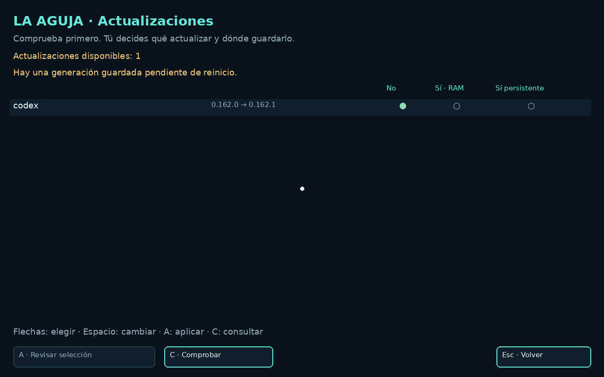
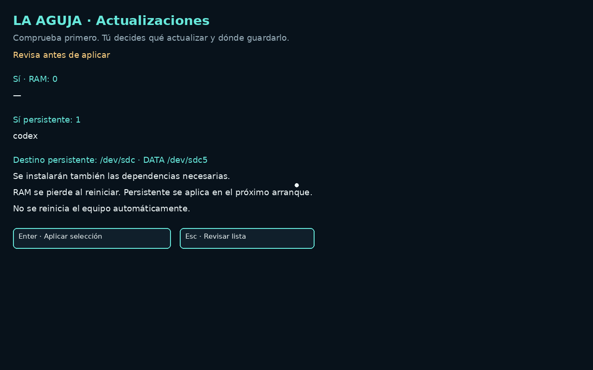
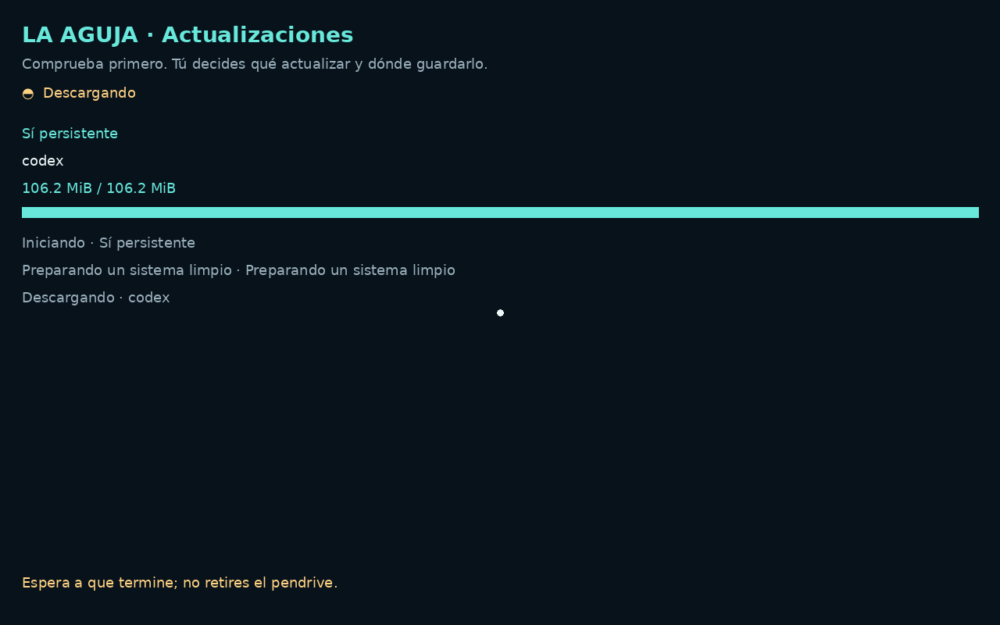
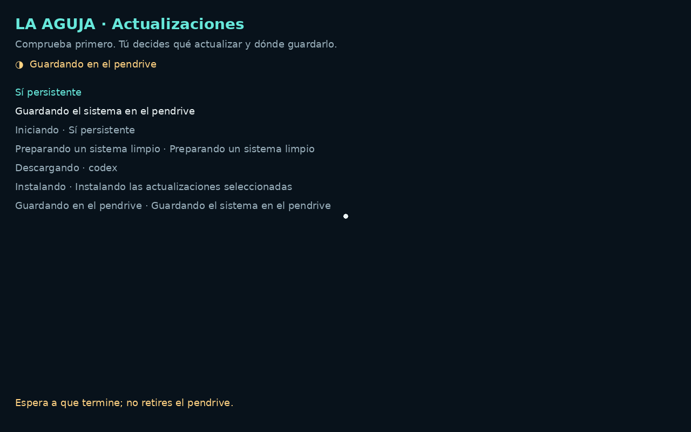
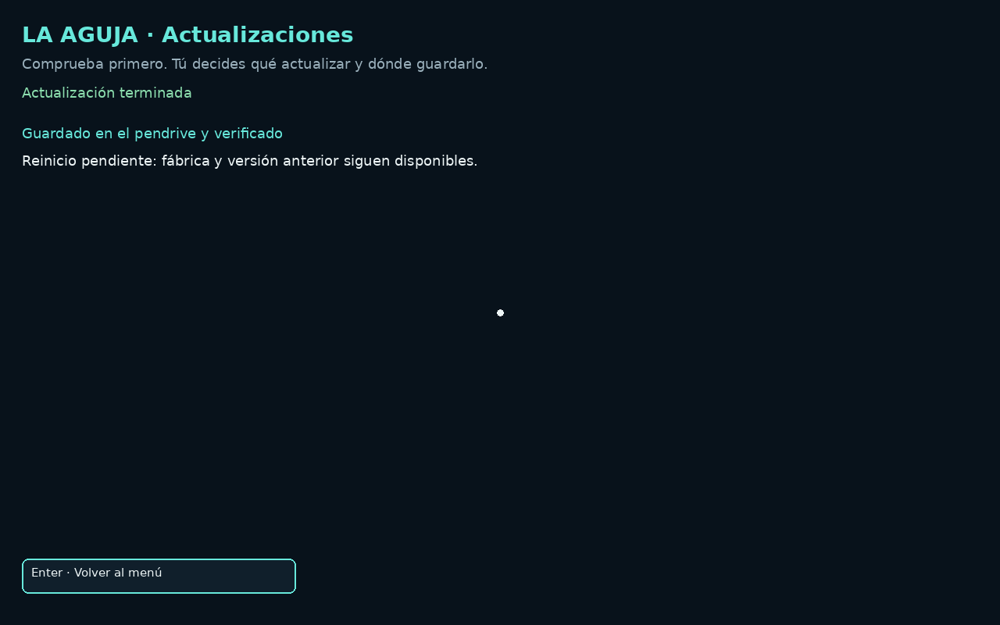
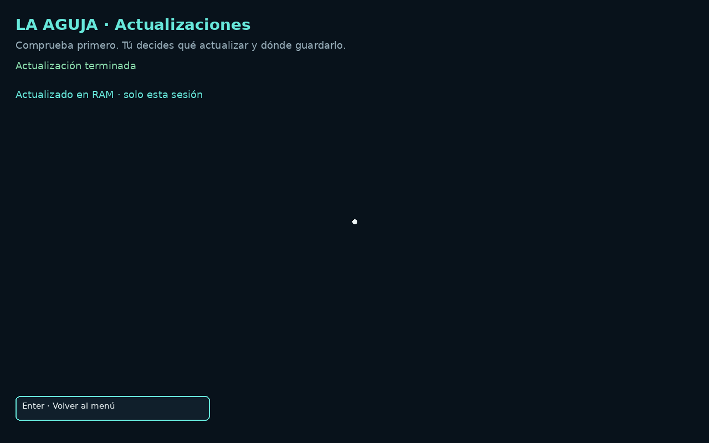

# Guia do utilizador · LA AGUJA

[Website](https://aguja.transcendenceia.net/pt/docs) · [English](../en/USER-GUIDE.md) · [Español](../es/USER-GUIDE.md)


## Uma plataforma de lançamento, não apenas um salva-vidas.

Dê a um agente avançado um objetivo, não apenas um comando de reparo. Ele pode analisar hardware, escolher ferramentas, gerar e executar scripts no escopo autorizado e conferir o resultado. O sistema instalado não precisa iniciar, nem mesmo existir.

A sessão live usa uma camada gravável em RAM sobre a imagem USB somente leitura. É Linux, não firmware, e o USB inteiro não é copiado para RAM. Os discos internos ficam intactos ao iniciar; você decide quando usá-los para gravação.

Inclui clientes de IA com acesso root, SSH, Python, Git, ferramentas de discos, debootstrap e arch-install-scripts. Amplie com pacotes compatíveis: Desde a versão 0.9.11 estão incluídos QEMU x86, qemu-img/qemu-nbd, OVMF e SeaBIOS; use KVM quando disponível ou TCG, mais lento, como alternativa. Motores de contêineres e ferramentas de compilação continuam opcionais; verifique RAM, armazenamento e compatibilidade. Salve os resultados importantes explicitamente; a RAM é temporária. IA na nuvem exige rede e sua conta; não há modelo local incluído.

[↗](https://aguja.transcendenceia.net/pt/docs#que-es)

## O teu primeiro USB

Faz cópia de um USB com capacidade suficiente. Obtém o Imager e a imagem do catálogo assinado. Mantém Ethernet DHCP, define idioma, teclado, nome e acesso SSH pessoal. IA e rede privada podem ficar desligadas neste primeiro teste.

Encripta perfis com segredos e guarda a frase fora do USB. Confirma modelo, capacidade e série antes de escrever. Aguarda a leitura verificada, arranca pelo USB e desbloqueia o perfil quando necessário. Ver o painel e identificar os discos basta para esta primeira volta.

```sh
aguja status
aguja doctor
lsblk -o NAME,SIZE,MODEL,FSTYPE,LABEL,MOUNTPOINTS
```

[↗](https://aguja.transcendenceia.net/pt/docs#primer-usb)

## Termos úteis

Live significa arrancar sem instalar. IMG configurável e ISO não são intercambiáveis no Imager. Disco, partição e montagem são conceitos diferentes; /dev/sda pode mudar. DHCP atribui endereços; SSH dá acesso cifrado e uma impressão digital do servidor.

Root/sudo é administração, não leitura apenas. Chave de inscrição, chave API, palavra-passe SSH e frase do perfil têm funções distintas. SHA-256 verifica bytes, não arranque universal. A frase do perfil não desbloqueia BitLocker/LUKS.

[↗](https://aguja.transcendenceia.net/pt/docs#glosario)

## Antes de começar

Verifica x86-64, USB e firmware. BIOS/UEFI são previstos; ARM, todos os chips Wi-Fi e Secure Boot assinado universal não são garantidos. Obtém autorização para equipamento e dados. Escolhe destino de recuperação diferente; para discos instáveis, pondera uma imagem primeiro.

A gravação substitui o USB. Windows ainda não tem cópia USB integrada: usa ferramenta externa. Linux oferece cópia completa verificada opcional, desligada por defeito, com espaço e permissões. Não é cópia do disco interno. BitLocker/LUKS exigem a chave do proprietário.

[↗](https://aguja.transcendenceia.net/pt/docs#preparacion)

## Transferir e abrir o Imager

Escolhe EXE Windows 10/11, AppImage, DEB Debian/Ubuntu ou arquivo Linux portátil no site oficial. Verifica SHA-256. Abre a aplicação no PC preparador; EXE/AppImage não são imagens para gravar no USB. Sem conta LA AGUJA.

O EXE não tem assinatura Authenticode reconhecida. AppImage pode precisar de permissão de execução; o arquivo portátil é alternativa. Escrever dispositivos exige elevação local. Abrir a aplicação não prova um USB preparado ou arrancável.

[↗](https://aguja.transcendenceia.net/pt/docs#descargas)

## Passo 1 · Escolher a imagem

Usa catálogo assinado ou .img local. Verificam-se Ed25519 e hashes; as partes são reunidas. Descomprime .img.zst antes de importar manualmente. Preparar uma imagem privada cria novo ficheiro, sem mudar a imagem pública.

Imager atual 0.9.2, imagem 0.9.0. As opções dependem das funcionalidades da imagem; sem tailscale-profile-v1 é recusada a preparação com rede privada. Verifica capacidade real, não só a etiqueta comercial.

[↗](https://aguja.transcendenceia.net/pt/docs#imagen)

## Passo 2 · Rede, idioma e nome

Escolhe idioma do live, teclado e variante; o idioma do Imager é independente. Usa um nome identificável. Ethernet DHCP facilita o início. Wi-Fi guardado é aplicado no arranque; sem rede, há seleção interativa.

Importar credenciais Wi-Fi pode pedir permissão local. Redes empresariais e portais cativos podem exigir NetworkManager manual. Se falhar o acesso online, separa rede, DNS, HTTPS e hora. Diagnóstico local pode continuar offline.

[↗](https://aguja.transcendenceia.net/pt/docs#red)

## Passo 3 · SSH

Define palavra-passe única ou chave pública autorizada, nunca chave privada. Porta padrão 22. Usa o IP real e compara a impressão digital. Mudar porta não substitui autenticação.

Utilizador e palavra-passe públicos de fábrica: aguja. Palavra-passe pessoal prevalece; vazia com chave pública permite só chave, sem chave mantém fábrica. Há sudo ilimitado. aguja password persiste no USB; sudo passwd aguja altera apenas a sessão.

```sh
ssh aguja@IP
```

[↗](https://aguja.transcendenceia.net/pt/docs#ssh)

## Passo 4 · Preparar IA

Integração com Codex CLI, OpenCode, Claude Code e Antigravity: chave API, sessão portátil compatível importada seletivamente ou login após arranque. Verificação de instalação não é autenticação ou inferência bem-sucedida.

Não copia chaveiro inteiro, histórico, hooks ou MCP. Sessões portáteis podem estar expiradas. Custos, quotas e dados dependem do fornecedor. Podes preparar sem credenciais IA; IA na nuvem não é prometida offline.

[↗](https://aguja.transcendenceia.net/pt/docs#ia-preparacion)

## Passo 5 · Tailscale/Headscale próprio

Acesso opcional: ativa rede privada, fornece chave auth/pre-auth autorizada e nome opcional. URL Headscale vazia usa Tailscale oficial; caso contrário, servidor HTTPS próprio. O live inscreve-se depois de rede e desbloqueio, não o PC preparador.

O cliente deve pertencer à rede autorizada e cumprir políticas. A chave de inscrição não é palavra-passe SSH. Inscrição não prova ACL: testa uma ligação SSH real. Desde Rescue Disk 1.0.2, o USB restaura a identidade Tailscale/Headscale guardada antes de ligar. A chave serve para a primeira inscrição, não para criar um nó em cada reinício. Estado idêntico não é reescrito; alterações são guardadas atomicamente e verificadas. O perfil automático não acrescenta desbloqueio; o cifrado mantém o existente. A validade e a revogação no servidor continuam a aplicar-se.

[↗](https://aguja.transcendenceia.net/pt/docs#tailnet)

## OpenSSH não é Tailscale SSH

O padrão é OpenSSH sobre a rede privada: palavras-passe/chaves, impressão digital e ACL de rede continuam relevantes. Tailscale SSH é avançado e exige servidor compatível e políticas SSH explícitas.

Separa inscrição, alcance do nó, porta TCP e autenticação. Não abras portas públicas nem alargues ACL para ocultar falhas. Consulta a documentação das versões da tua infraestrutura.

[↗](https://aguja.transcendenceia.net/pt/docs#politicas)

## Segredos e encriptação

O perfil contém potencialmente Wi-Fi, SSH, IA e chaves de inscrição. Encripta a cápsula e guarda a frase separadamente. Desbloqueia localmente antes de carregar dados. Modelos .aguja e cópias também são sensíveis.

Não encripta todo AGUJA_DATA nem protege segredos carregados contra root. persistent_home=no perde HOME/tokens no reinício; yes guarda sem encriptação. aguja.conf em claro é fisicamente legível. Não publiques perfis, chaves ou imagens privadas.

[↗](https://aguja.transcendenceia.net/pt/docs#secretos)

## Windows · BitLocker

Linux não remove BitLocker. Obtém do proprietário a chave certa para o volume. Frase do perfil e palavra-passe SSH não são chaves BitLocker. LA AGUJA não quebra a encriptação.

No Windows, o Imager pode consultar chaves disponíveis e incluir as explicitamente escolhidas na imagem privada. Protege o perfil e guarda outra cópia. Ver a chave não prova o volume desbloqueado. Captura Windows histórica 0.8.1, não nova execução nativa 0.9.2.

[↗](https://aguja.transcendenceia.net/pt/docs#bitlocker)

## Passo 7 · Preparar, gravar e verificar

Revê imagem, proteção e resumo. Criar imagem privada gera ficheiro; preparar e gravar também escreve no dispositivo. Confirma modelo, série e capacidade real no diálogo nativo. Cancela se houver dúvida. Autoriza apenas a operação pretendida em UAC/Polkit.

Aguarda escrita e leitura completa sem desligar USB. Confere o resultado. Verificação de bytes não garante firmware: testa arranque no teu equipamento. A cópia USB Windows deve estar feita externamente.

[↗](https://aguja.transcendenceia.net/pt/docs#grabar)

## Arrancar, desbloquear, ligar

Seleciona USB no menu do fabricante. O painel mostra rede/SSH. Perfil encriptado: aguja profile unlock na consola local. O painel gráfico pode cair para consola de texto conforme hardware.

Usa IP real. .local depende de mDNS/multicast e pode mudar por conflito. SSH funciona na LAN sem tailnet. Compara impressão digital e verifica estado/discos. Painel visível não implica montagem ou reparação interna.

```sh
aguja profile unlock
aguja status
```

[↗](https://aguja.transcendenceia.net/pt/docs#arranque)

## Atualizações interativas do live

Abre Atualizações ou executa aguja update menu. Primeiro procura atualizações: aparecem as versões instaladas e disponíveis. Nada é instalado automaticamente.

Em cada linha: Não, Sim · RAM ou Sim persistente. Não não altera nada. RAM dura só nesta sessão. Persistente guarda um sistema limpo e verificado em DATA deste USB para o próximo arranque.

Usa rato, setas e Espaço. A revê contagens e destino exato; Enter aplica. Uma release Rescue completa exige persistência e uma operação separada dos componentes.

Acompanha bytes ou progresso APT, preparação, instalação, gravação USB, verificação e seleção de arranque. Sem total mensurável mostra atividade, não percentagens inventadas. Espera pelo fim.

O resultado fica até Voltar ao menu. Não há reinício automático nem sucesso falso após falha. Fábrica e geração anterior continuam disponíveis; aguja update rollback muda o próximo arranque.

Na 1.0.2, o arranque normal evita recalcular o hash do sistema completo. A verificação em segundo plano avisa sem instalar nada. Tarefas confirmadas continuam após Escape ou fechar SSH; reabre Atualizações para recuperar progresso e resultado. Não retires o USB durante uma escrita ativa.

USB gravável compatível com 1.0, espaço DATA e RAM suficientes. A geração pendente é preservada como base; segredos e workspace não são copiados. Editar CFG não atualiza um USB antigo.

```sh
aguja update menu
aguja update status --json
aguja update check --json
aguja update rollback
```













Capturas reais da VM; QA com versão oficial anterior controlada de Codex. Pacote demonstrativo sintético. Versões não garantem atualizações disponíveis hoje.

## Autenticar IA no navegador local

aguja login codex, claude ou antigravity abre Chromium com sandbox, login oficial e consola na mesma PTY. Copiar foca a consola; cola explicitamente com Ctrl+Shift+V. Fechar devolve o terminal. Sem QR nem consentimento automático.

OpenCode conserva opencode auth login. SSH/série/sem ecrã usam método nativo; callback localhost remoto não é encaminhado automaticamente. API e sessão importada são caminhos separados. Capturas sintéticas não provam login real ou inferência.

```sh
aguja login codex
aguja login claude
aguja login antigravity
opencode auth login
```

[↗](https://aguja.transcendenceia.net/pt/docs#ia-login)

## Primeiro diagnóstico

Define pergunta e recolhe estado, identidade, sistemas de ficheiros e montagens. Usa aguja doctor e o inventário abaixo. Identifica USB, origem e destino por modelo/tamanho/identificadores, não letras supostas.

Verifica opções de montagem de leitura apenas e comportamento do journal antes de consultar ficheiros. Preserva observações. Discos instáveis podem exigir ddrescue com mapa, não reparações repetidas no original.

```sh
aguja doctor
lsblk -o NAME,SIZE,MODEL,SERIAL,FSTYPE,LABEL,MOUNTPOINTS
findmnt
```

[↗](https://aguja.transcendenceia.net/pt/docs#primer-diagnostico)

## Trabalhar com um agente

Especifica objetivo, computador/disco exato, ações permitidas, cópia e condições de paragem. Pede estado atual e provas antes de mudar. Confirma ficheiros recuperados ou arranque independentemente do agente.

Codex Seguro em 0.9.10 usa sandbox workspace-write sem rede. Cada ferramenta exige uma nova confirmação humana; sair do sandbox exige aprovação humana. A conta mantém sudo fora do sandbox. Outros clientes mantêm as suas confirmações; YOLO continua sem restrições. Escolha com aguja agent NAME; Escape cancela. Nenhum modo autoriza ações fora do seu pedido.

[↗](https://aguja.transcendenceia.net/pt/docs#trabajo-ia)

## Ferramentas e comandos

aguja tools lista ferramentas. ddrescue cria imagens com mapa; TestDisk/PhotoRec recuperam; rsync copia; smartctl/nvme-cli examinam hardware. Volumes e encriptação exigem alvo e chave certos.

Comandos abaixo são de orientação. Não formates, instales bootloader ou escrevas partições em dispositivo adivinhado. Consulta manuais e trabalha em cópia quando adequado. Ferramentas tradicionais não exigem nuvem; não garantem toda recuperação.

```sh
aguja tools
aguja status --disks
aguja status --json
aguja context
aguja help
```

[↗](https://aguja.transcendenceia.net/pt/docs#herramientas)

## O que você poderia construir desde o boot?

Use as ferramentas Linux incluídas ou adicione dependências do projeto. São missões adaptáveis, não funções de um clique nem cenários todos já testados.

[↗](https://aguja.transcendenceia.net/pt/docs#casos)

## Percurso profissional

Regista autorização, hardware, versão/hash, estado, discos e plano. Trabalha em cópia, identifica provas e ligação ao original. Para media instável, conserva mapa e condições de paragem.

Mudanças pequenas com propósito e resultado. Verifica dados/arranque, não apenas código de saída. Encripta perfis .aguja reutilizáveis e revê credenciais antigas. Sem dados ou chaves de clientes em tickets públicos.

[↗](https://aguja.transcendenceia.net/pt/docs#profesional)

## Resolver por camadas

Sem arranque: arquitetura, integridade, firmware, consola texto. Sem rede: ligação/Wi-Fi, DHCP, DNS, HTTPS, hora. Sem SSH: IP/porta, serviço, política, autenticação. Sem tailnet: chave, URL, validade, uso único consumido.

Sem IA: método, conta, Internet, callback. Sem perfil: funcionalidades e desbloqueio. Sem disco: controlador/inventário antes de escrever. doctor saudável não prova ACL, OAuth nem todo hardware.

[↗](https://aguja.transcendenceia.net/pt/docs#problemas)

## Terminar sem acessos esquecidos

Resume observações, mudanças e verificações. Fecha sessões, termina escritas e desliga corretamente. Verifica ficheiros no destino e mantém original/cópias até aceitação.

Remove nós temporários e revoga chaves inúteis. Verifica tokens persistentes no USB. Trata imagens/perfis privados por processo aprovado e recuperável. Não retires acessos alheios nem destruas provas. Declara limites restantes.

[↗](https://aguja.transcendenceia.net/pt/docs#terminar)

## O que está verificado

Edição pública sem contas LA AGUJA ou relay proprietário. Testes de preparação, pacotes e VM cobrem percursos específicos, não todos os PCs. Imager 0.9.2 corrige título em sete idiomas; imagem permanece 0.9.0. Capturas antigas mantêm versão/proveniência.

Leitura verificada não é arranque universal. Painel/CLI/sessão portátil não é login IA; inscrição local não prova SSH. Windows não tem cópia USB integrada nem assinatura Authenticode reconhecida. Sem Secure Boot assinado universal.

[↗](https://aguja.transcendenceia.net/pt/docs#validacion)

## Referências e próximos passos

Links superiores: transferências e código. Referência espanhola aprofundada mantém os 26 capítulos originais; este guia cobre as mesmas etapas em português. Capturas históricas/sintéticas conservam origem. Imprime para PDF português; o PDF histórico separado é espanhol.

Consulta documentação oficial OpenSSH, Tailscale/Headscale, ddrescue, TestDisk e Microsoft BitLocker para as tuas versões. Código GPL-3.0-or-later; terceiros com licenças próprias. Tickets com versões e sintomas expurgados, sem palavras-passe, tokens ou imagens privadas.

[↗](https://aguja.transcendenceia.net/pt/docs#referencias)
