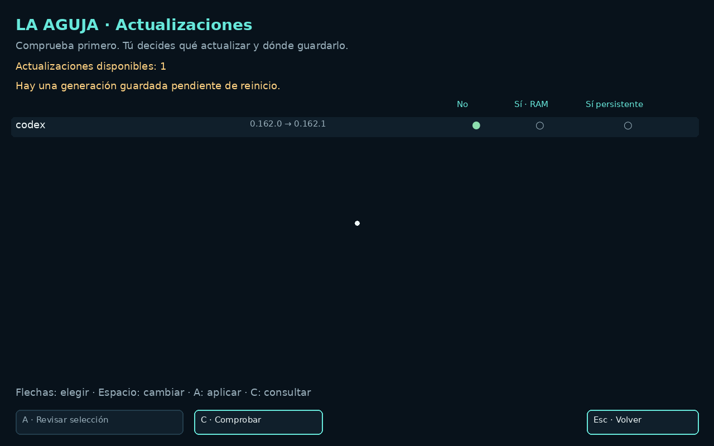
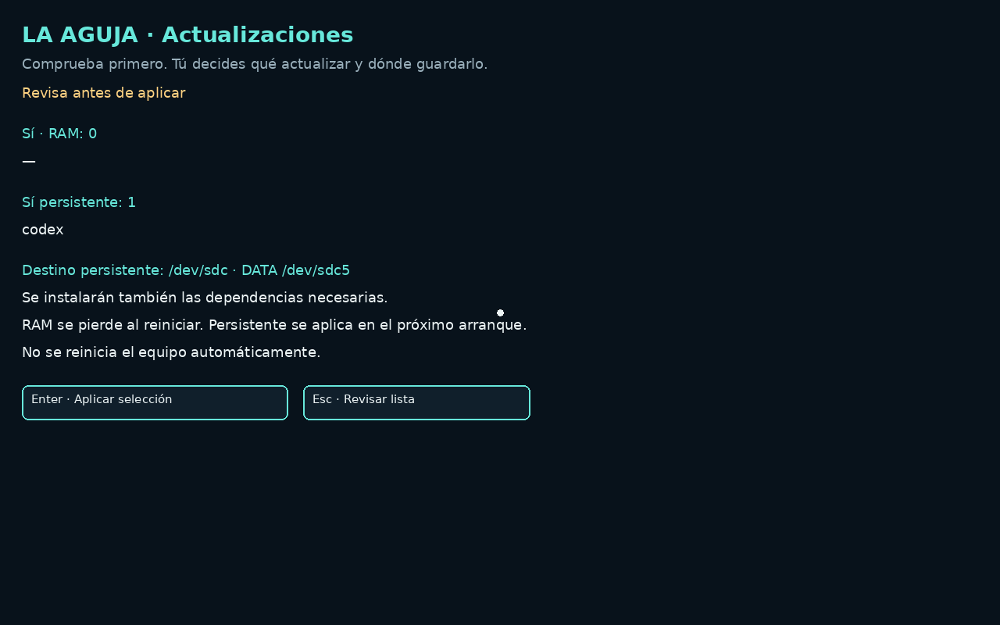
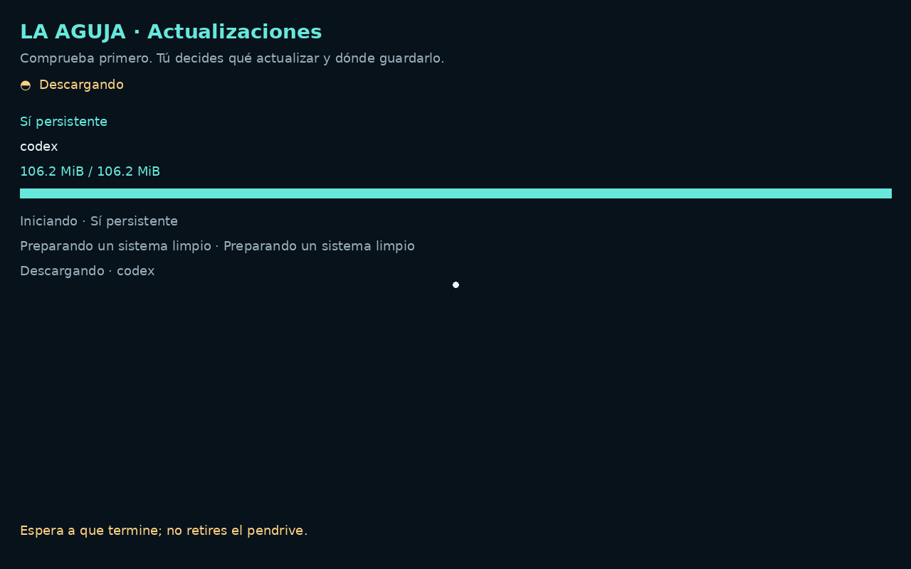
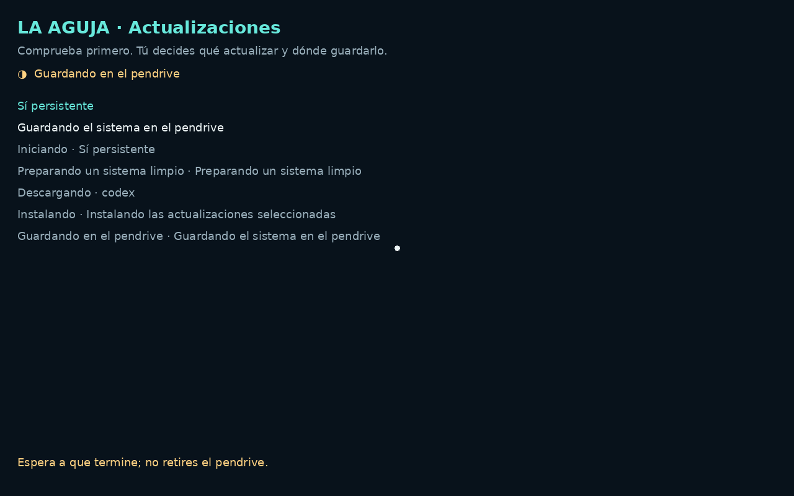
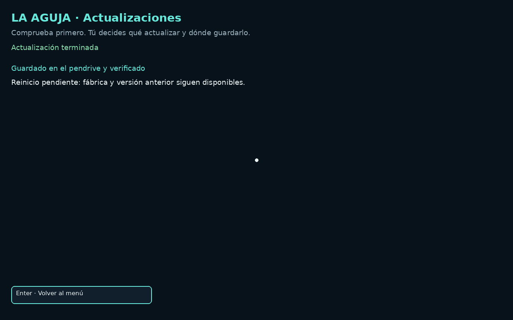
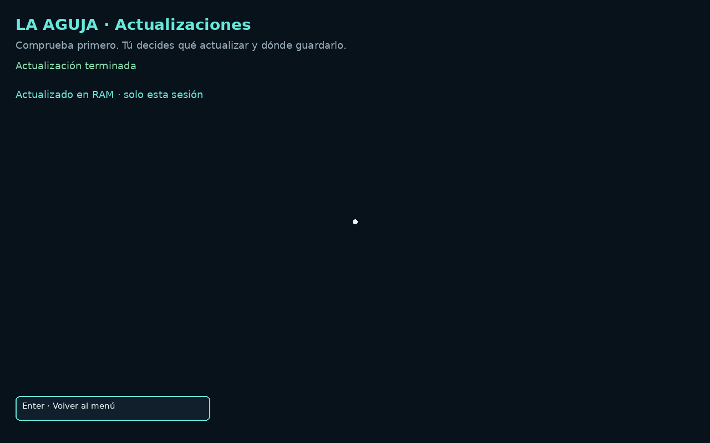

# 用户指南 · LA AGUJA

[Website](https://aguja.transcendenceia.net/zh/docs) · [English](../en/USER-GUIDE.md) · [Español](../es/USER-GUIDE.md)


## 远不止救援盘：这是一座便携移动操作台。

LA AGUJA 将可启动的 x86-64 Linux、口袋级 ESP32 Tailnet 节点、跨平台烧录器与无界面 Agent Skill 融为一体——全部运行在你自己的硬件与私有网络中。

给先进智能体一个目标，而不仅是一条修复命令。它可以分析硬件、选择工具、在获准范围内生成并执行脚本，再验证结果。磁盘中的系统不必启动，甚至不必存在。

Live 会话使用 RAM 中的可写叠加层，底层是 USB 上的只读镜像。这是 Linux，不是固件，也不会将整个 USB 复制到 RAM。启动时不改动内部磁盘；是否写入由你决定。

已包含可使用 root 权限的 AI 客户端、SSH、Python、Git、磁盘工具、debootstrap 和 arch-install-scripts。从 0.9.11 起已内置 QEMU x86、qemu-img/qemu-nbd、OVMF 和 SeaBIOS；支持时使用 KVM，否则可使用较慢的 TCG。容器引擎和构建工具仍需按需添加；请检查 RAM、存储和兼容性。请主动保存重要成果；RAM 状态是临时的。云端 AI 需要网络和你自己的账户，并未包含本地模型。

## 准备第一个 USB

先备份容量足够的 USB。下载 Imager，从签名目录选择镜像。保留以太网 DHCP，设置语言、键盘、主机名和自己的 SSH 密码或公钥。首次测试可关闭 AI 和私有网络。配置含机密时请加密，并把解锁口令保存在 USB 之外。写入前核对型号、容量和序列号；等待完整回读验证。通过固件菜单从 USB 启动，必要时解锁配置。看到面板并识别磁盘即完成首次练习，无需登录 AI 或恢复文件。

```sh
aguja status
aguja doctor
lsblk -o NAME,SIZE,MODEL,FSTYPE,LABEL,MOUNTPOINTS
```

[↗](https://aguja.transcendenceia.net/zh/docs#primer-usb)

## 常见术语

Live 系统无需安装即可启动。可配置 IMG 和启动 ISO 在 Imager 中不可互换。磁盘是整个设备，分区是其中区域，挂载使文件可访问；/dev/sda 等名称可能变化。DHCP 自动分配地址；SSH 提供加密终端和服务器指纹。Root/sudo 是管理员权限，不是只读沙箱。节点注册密钥、API 密钥、SSH 密码和配置口令用途不同。SHA-256 验证字节，不保证启动兼容性。配置口令无法解锁 BitLocker/LUKS。

[↗](https://aguja.transcendenceia.net/zh/docs#glosario)

## 开始前：硬件、许可与备份

确认 x86-64、USB 启动和固件支持。提供 BIOS/UEFI 路径，但不保证 ARM、所有 Wi-Fi 芯片或通用已签名 Secure Boot。取得设备和数据的授权，选择独立恢复目标。故障磁盘应考虑先制作镜像。写入会替换 USB 内容。Windows 暂无内置 USB 备份，请使用外部工具；Linux 提供可选完整验证备份，默认关闭，需要空间和权限。这不是内部磁盘备份。加密卷仍需要所有者正确的 BitLocker/LUKS 密钥。

[↗](https://aguja.transcendenceia.net/zh/docs#preparacion)

## Flash Imager 1.2.0：下载、USB 配置、ESP32 IoT 与 Agent Skill 1.3.0

从官方 v1.2.0 发布页下载 Windows 便携 EXE 或 Linux AppImage、DEB、便携压缩包。以普通用户身份运行，仅物理 USB 写入请求 UAC/Polkit。Windows 版本内置独立 esptool.exe，烧录 ESP32 无需安装 Python。

在 USB 模式下，“配置与 USB”可保存/打开加密 .aguja 模板（支持 imager-profile-v2 扩展项）并直接编辑现有 U 盘 CFG 而不覆盖 DATA。在 IoT · MCU 模式下，Flash Imager 1.2.0 自动识别 USB 连接的 ESP32 芯片，内置覆盖 11 款开发板的 6 套 v1.4.0 固件，纯 JS 生成 48 KiB NVS v2 分区（默认关闭 SoftAP），支持串口启动验证与一键清空闪存。

如需无界面自动化，Agent Skill 1.3.0 在 Node 22+ 下提供相同的 .img 引擎与 ESP32 NVS v2 生成器（iot-boards、iot-nvs），仅生成校验文件而不自动烧录设备。Imager 更新仅在你选择时校验签名目录并下载。

## 步骤 1 · 选择兼容镜像

使用签名目录或本地 .img。目录检查 Ed25519 和哈希，并合并分卷。手动导入 .img.zst 前先解压。私人配置生成新文件，不修改公开镜像。目前 Imager 为 0.9.2，救援镜像为 0.9.0。选项取决于镜像支持；不含 tailscale-profile-v1 的镜像会拒绝私有网络注册配置。核对实际容量，而非 USB 商业标签。

[↗](https://aguja.transcendenceia.net/zh/docs#imagen)

## 步骤 2 · 网络、语言与主机名

选择 Live 语言、键盘布局及变体；Imager 界面语言独立设置。使用可识别的主机名。以太网 DHCP 是最简单的起点；保存的 Wi-Fi 会在启动时连接，无网络时可交互选择。导入 Wi-Fi 密码可能需要本地许可。企业网络或门户可能需要手动配置 NetworkManager。分别检查网络、DNS、HTTPS 和时间；本地诊断仍可离线进行。

[↗](https://aguja.transcendenceia.net/zh/docs#red)

## 步骤 3 · SSH 访问

使用唯一密码或获授权操作者的公钥，切勿粘贴私钥。默认端口 22；使用实际 IP 并核对主机指纹。改端口不能代替身份验证。出厂用户和公开密码都是 aguja。个人密码优先；空密码配公钥为仅公钥访问，没有公钥时保持出厂访问兼容性。账户拥有无限 sudo。aguja password 把新密码保存在 USB；sudo passwd aguja 只改变当前会话。

```sh
ssh aguja@IP
```

[↗](https://aguja.transcendenceia.net/zh/docs#ssh)

## 步骤 4 · 准备 AI

支持 Codex CLI、OpenCode、Claude Code 和 Antigravity 集成：自己的 API 密钥、选择性导入兼容便携会话，或启动后登录。CLI 安装检查不证明登录或推理成功。不会复制整个密钥库、历史、钩子或 MCP 配置。便携会话可能已过期。费用、配额和发送数据由提供商决定。可以不配置 AI 凭据；不承诺云端 AI 离线工作。

[↗](https://aguja.transcendenceia.net/zh/docs#ia-preparacion)

## 步骤 5 · 自己的 Tailscale/Headscale

远程访问可选。启用私有网络并提供授权 auth/pre-auth 密钥，可选节点名。Headscale URL 留空使用官方 Tailscale，否则填写自己的 HTTPS 服务。Live 在网络可用、配置解锁后注册，不注册准备电脑。客户端必须属于授权网络并满足策略。注册密钥不是 SSH 密码。注册成功不证明 ACL 允许连接，应从授权客户端测试真实 SSH。

从 Rescue Disk 1.0.2 起，USB 在连接前恢复已保存的 Tailscale/Headscale 身份。注册密钥用于首次注册，不会在每次重启时创建新节点。状态未变则不重复写入，变更会原子保存并校验。自动配置不增加解锁步骤，加密配置保留原有解锁。服务器端到期与撤销仍然有效。 LA AGUJA IoT（ESP32 v1.4.0）节点同样通过 WireGuard/DERP 直接接入你自己的 Tailscale 或 Headscale，作为口袋级出口节点、动态上游子网路由与 DNS 中继，可通过 REST API 或 aguja-iot.py 远程控制。

## OpenSSH 与 Tailscale SSH

默认是私有网络上的普通 OpenSSH，仍需密码/公钥、指纹和允许访问的网络 ACL。Tailscale SSH 是高级选项，需要兼容服务和明确 SSH 策略。遇到问题要区分注册、节点连通性、TCP 端口和身份验证，不要为掩盖认证错误而开放公网端口或扩大 ACL。参考实际部署版本的文档。

[↗](https://aguja.transcendenceia.net/zh/docs#politicas)

## 机密与加密边界

私人配置可能包含 Wi-Fi、SSH、AI 和节点注册密钥。加密配置胶囊，单独保存口令，启动时先本地解锁。可复用 .aguja 模板及备份同样敏感。胶囊并不加密整个 AGUJA_DATA，也无法在解锁后防止 root 读取。persistent_home=no 重启丢失 HOME/令牌；yes 在 USB 上明文保存。明文 aguja.conf 可被物理读取。不要公开私人镜像、配置或密钥。

[↗](https://aguja.transcendenceia.net/zh/docs#secretos)

## Windows · 理解 BitLocker

启动 Linux 不会移除 BitLocker。向所有者取得与目标卷对应的恢复密钥。配置口令和 SSH 密码不是 BitLocker 密钥，LA AGUJA 不破解加密。Windows Imager 可检查可用密钥，并仅在明确选择后加入私人镜像。保护配置并另存恢复副本。显示密钥不证明卷已解锁。Windows 截图是历史 0.8.1 证据，不是新的原生 0.9.2 执行。

[↗](https://aguja.transcendenceia.net/zh/docs#bitlocker)

## 步骤 7 · 准备、写入与验证

检查镜像、保护模式及摘要。创建私人镜像只生成文件；准备并写入 USB 还会写目标设备。在原生确认中比较型号、序列号、实际容量；不确定就取消。仅对预期操作授权 UAC/Polkit。等待完整写入和回读，不要拔出 USB，并检查结果。字节验证不代表所有固件兼容，应测试目标硬件。Windows USB 备份必须事先外部完成。

[↗](https://aguja.transcendenceia.net/zh/docs#grabar)

## 启动、解锁并连接

在制造商启动菜单选择 USB，面板显示网络/SSH。加密配置在本地控制台执行 aguja profile unlock。硬件不支持图形时可回退到文字控制台。使用实际 IP；.local 依赖 mDNS/组播，重名时可能改变。无需 tailnet 也能在局域网 SSH。核对指纹后检查状态和磁盘。看到面板不代表内部磁盘已被挂载或修复。

```sh
aguja profile unlock
aguja status
```

[↗](https://aguja.transcendenceia.net/zh/docs#arranque)

## 交互式 live 更新

打开更新面板，或运行 aguja update menu。先检查更新：列表显示已安装版本和可用版本。不会自动安装。

每行选择“不”“是 · RAM”或“是，持久保存”。“不”不更改任何内容。RAM 仅影响本次会话，重启后丢失。持久更新将干净且经过验证的系统保存到此 USB 的 DATA，供下次启动使用。

使用鼠标、方向键和空格选择。A 显示数量及准确保存目标，Enter 应用。完整 Rescue Disk 版本必须持久保存，并与组件更新分开操作。

可测量时显示下载字节或 APT 进度，随后显示准备、安装、写入 USB、验证及启动选择。没有可测量总量时显示活动状态，不虚构百分比。完成前不要拔出 USB。

结果将保留到点击返回菜单。不会自动重启，也不会将失败或部分完成报告为成功。出厂系统和上一代仍可选择；aguja update rollback 更改下次启动选择。

1.0.2 正常启动不再重复计算整个系统的哈希。后台检查只提示更新，不自动安装。确认后的任务在按 Escape 返回或关闭 SSH 后继续运行；重新打开更新可恢复进度与结果。正在写入时不要拔出 USB。

需要兼容 1.0 的可写 USB、足够 DATA 空间及 RAM。保留待启动代作为基础，不复制个人密钥和 workspace。仅编辑 CFG 不会更新旧 USB 系统。

```sh
aguja update menu
aguja update status --json
aguja update check --json
aguja update rollback
```













真实虚拟机截图；QA 使用受控的旧版官方 Codex。软件包演示为合成测试。图中版本不代表今天必有可用更新。

## 本地浏览器中的 AI 登录

aguja login codex、claude 或 antigravity 可打开有沙箱的 Chromium 官方登录及同一 PTY 控制台。复制仅聚焦控制台，使用 Ctrl+Shift+V 明确粘贴；关闭返回原终端。不使用 QR，不自动授权。OpenCode 保持 opencode auth login。SSH、串口、无屏幕使用原生方法，远程 localhost 回调不自动转发。API 与会话导入是不同途径。合成截图不证明真实登录或推理。

```sh
aguja login codex
aguja login claude
aguja login antigravity
opencode auth login
```

[↗](https://aguja.transcendenceia.net/zh/docs#ia-login)

## 首次诊断：先理解再修复

提出具体问题，收集状态、设备身份、文件系统和挂载。运行 aguja doctor 与下方清单。按型号、大小、标识符识别 USB、源和目标，不猜设备字母。访问文件前检查只读挂载及文件系统日志行为。修改前保存观察结果。故障磁盘可能需要 ddrescue 镜像与映射文件，而不是反复修复原盘。

```sh
aguja doctor
lsblk -o NAME,SIZE,MODEL,SERIAL,FSTYPE,LABEL,MOUNTPOINTS
findmnt
```

[↗](https://aguja.transcendenceia.net/zh/docs#primer-diagnostico)

## 与智能体协作

明确目标、具体电脑/磁盘、授权操作、备份位置和停止条件。先要求实时状态和证据，再修改。独立验证恢复文件或启动结果。0.9.10 的 Codex Safe 使用 workspace-write 沙箱，沙箱内禁用网络。每个工具都需要新的人工确认；离开沙箱需要人工批准。账户在沙箱外保留 sudo。其他客户端保留各自的确认机制；YOLO 仍不受限制。通过 aguja agent NAME 选择；Escape 取消。任何模式都不允许超出你的请求范围。

[↗](https://aguja.transcendenceia.net/zh/docs#trabajo-ia)

## 救援工具与命令

aguja tools 展示工具。ddrescue 制作带映射的镜像；TestDisk/PhotoRec 恢复；rsync 复制；smartctl/nvme-cli 检查硬件。卷和加密工具仍需正确设备及密钥。下方命令用于了解状态。不要对猜测设备格式化、安装引导器或写分区。参考工具手册，必要时在副本上工作。传统工具无需云端 AI，但不保证恢复所有数据。

```sh
aguja tools
aguja status --disks
aguja status --json
aguja context
aguja help
```

[↗](https://aguja.transcendenceia.net/zh/docs#herramientas)

## 从启动开始，你能构建什么？

使用已包含的 Linux 工具，或添加项目所需依赖。这些是可调整的任务构想，并非一键功能，也不是所有场景都已完成测试。

[↗](https://aguja.transcendenceia.net/zh/docs#casos)

## 专业流程：证据与可重复性

记录许可、硬件、版本/哈希、初始状态、磁盘和计划。尽可能使用副本，为证据标注并保留与原件关联。对不稳定介质保留映射及停止条件。小步修改，记录目的和结果；验证数据/启动，而非仅退出码。可复用 .aguja 配置应加密并检查过期凭据。不得把客户数据或密钥放进公开问题或演示。

[↗](https://aguja.transcendenceia.net/zh/docs#profesional)

## 按层排查问题

无法启动：架构、完整性、固件、文字控制台。无网络：链路/Wi-Fi、DHCP、DNS、HTTPS、时间。无 SSH：IP/端口、服务、策略、认证。无 tailnet：密钥、URL、有效期、一次性密钥已用。无 AI：方法、账户、网络、回调。配置未加载：镜像功能/解锁。磁盘未见：先检查控制器和清单，勿写入。doctor 正常不证明 ACL、OAuth 或全部硬件兼容。

[↗](https://aguja.transcendenceia.net/zh/docs#problemas)

## 结束时不要遗留访问

总结观察、修改和验证，关闭会话，完成写入并正常关机。检查目标文件，保留原盘及备份直到所有者接受。删除临时节点并撤销无用密钥，检查 USB 持久令牌。按已授权、可恢复流程处理私人镜像/配置；不撤销无关所有者访问，也不销毁证据。说明剩余限制。

[↗](https://aguja.transcendenceia.net/zh/docs#terminar)

## Rescue 1.1.2、Imager 1.2.0 与 IoT ESP32 验证范围

发布验证文档涵盖 Rescue Disk 1.1.2（BIOS/UEFI 启动、LUKS 解锁、持久化代次、回滚与 tailnet 身份）、Linux 与 Windows 下的 Flash Imager 1.2.0（USB 配置、CFG 编辑以及 ESP32-C6 与 ESP32-S3-WROOM-1 N16R8 实机烧录，Windows 免 Python）以及 Agent Skill 1.3.0 确定性压缩包。

截图保留其标注的历史版本与合成测试数据。IoT 实机验证覆盖 Seeed Studio XIAO ESP32-C6 与 ESP32-S3-WROOM-1 N16R8，其余 ESP32 子系列随附已编译打包的 v1.4.0 固件。测试结果不代表对所有硬件、Secure Boot 或第三方 AI 账户的通用保证。

## 参考与下一步

顶部链接提供下载和代码。西班牙语详细参考保留原始 26 章，本指南以简体中文覆盖相同操作阶段。截图保留历史版本与合成测试来源。打印本页可保存中文 PDF；另行发布的历史 PDF 为西班牙语。查看实际版本的 OpenSSH、Tailscale/Headscale、ddrescue、TestDisk 和 Microsoft BitLocker 官方文档。项目代码 GPL-3.0-or-later，第三方保留自身许可。问题报告附版本和脱敏现象，不附密码、令牌、私钥或私人镜像。

[↗](https://aguja.transcendenceia.net/zh/docs#referencias)
